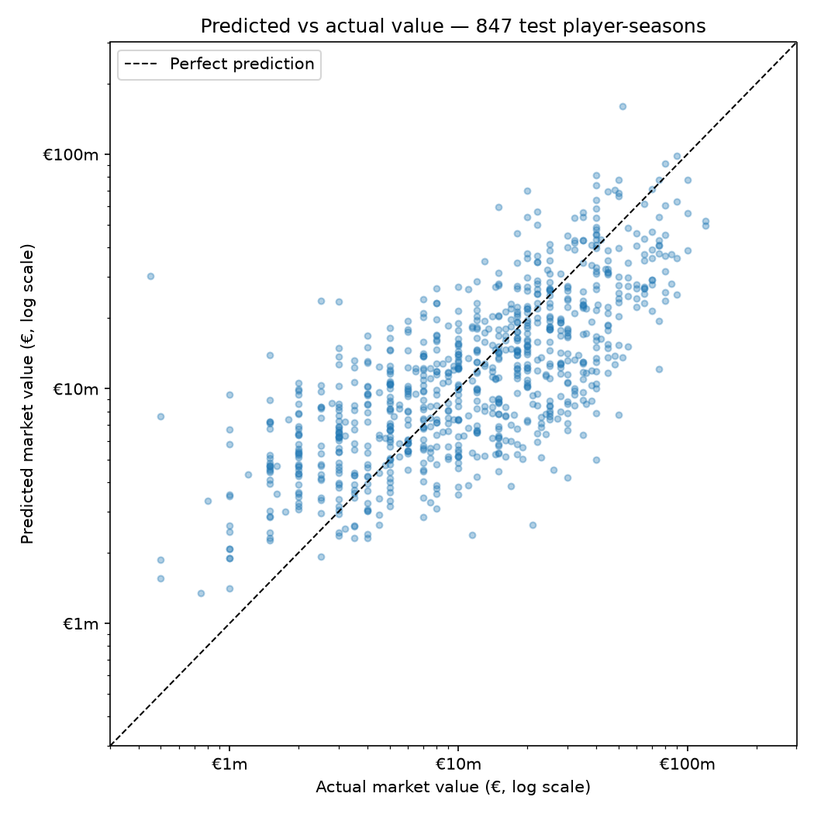
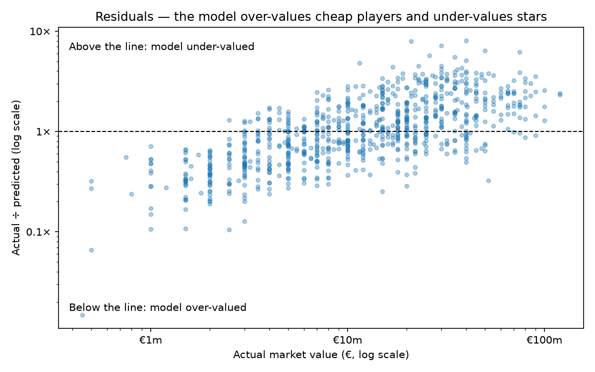

# ⚽ EPL Transfer Value Predictor

Can a Premier League player's season stats predict what he's worth?

This project trains a linear regression on **4,232 Premier League player-seasons (2012/13 to 2025/26)** of Transfermarkt data, then lets you search any player and compare the model's valuation with Transfermarkt's.

**Try it live:** _link coming soon_

## Headline result

The model explains about half of what drives market value, and the half it misses is the interesting part.

- **Typical error of €5.4m** (median) on 847 player-seasons the model never saw during training.
- **Age is the biggest single driver.** Each extra year costs about **12%** of a player's value, more than an extra goal adds (**+7%**).
- **It badly under-values stars.** Players worth €100m+ come out at around €40–55m. Their price depends on things season stats can't see: club, contract length, potential and reputation.


## How it works

```
Transfermarkt CSVs (~900 MB, Kaggle)
  │  src/load_data.py     keep Premier League appearances only (1.9M → 149,751 rows)
  ▼
  │  src/build_table.py   one row per player per season: totals, age, end-of-season value
  ▼                       (7,422 player-seasons)
  │  src/clean_table.py   drop goalkeepers, keep 900+ minutes, handle missing values
  ▼
data/processed/player_seasons_clean.csv   (4,232 rows, committed)
  │  src/train_model.py   train linear regression, evaluate, save the model
  ▼
models/value_model.joblib
  │  src/predict.py       find a player and predict his value (CLI + reusable functions)
  │  src/app.py           Streamlit web app built on predict.py
  ▼  src/charts.py        evaluation charts
```

### Data

[Transfermarkt dataset on Kaggle](https://www.kaggle.com/datasets/davidcariboo/player-scores) by David Cariboo ([source repo](https://github.com/dcaribou/transfermarkt-datasets)).

| File | One row per | Used for |
|---|---|---|
| `appearances.csv` | player per match | goals, assists, minutes |
| `games.csv` | match | which season a match was in |
| `players.csv` | player | name, date of birth, position, height |
| `player_valuations.csv` | valuation update | market value at the time |

### Decisions

| Decision | Why |
|---|---|
| **Value = last valuation of each season** (seasons run July–June) | reflects how that season went |
| **Age measured on 1 September** of each season | every player measured the same way |
| **Goalkeepers removed** | their value comes from saves and clean sheets, which aren't in the data |
| **900+ minutes only** (10 full games) | tiny samples give extreme, misleading stats |
| **Missing value, age or foot → row dropped; missing height → median** | never invent the target; height barely matters |
| **Model trained on log(value)** | values range 800× (€250k to €200m); logs stop a few superstars dominating and make negative predictions impossible |

Features: age, season, games, minutes, goals, assists, height and position (one-hot encoded, attacker as baseline). Data is split 80/20 into training and test sets with a fixed random seed.

## Results

Scores on the 847-row test set the model never trained on:

| | Baseline (euros) | Log model (used in the app) |
|---|---|---|
| Median error (typical player) | €8.0m | **€5.4m** |
| Mean absolute error | €10.3m | **€9.5m** |
| Negative predictions | 64 | **0** |
| R² (in euros) | **0.48** | 0.40 |
| Train R² vs test R² | 0.49 vs 0.48 | no overfitting |

The log model is better for the typical player and never predicts a negative price. Its lower R² comes from under-valuing a handful of very expensive players, and R² punishes big misses on big numbers heavily. Neither model should be trusted above roughly €50m.



The residuals show the pattern clearly: cheap players are over-valued and stars are under-valued, so the model pulls everyone towards the middle.



### Where it goes wrong

| Player, season | Transfermarkt | Model | Why |
|---|---|---|---|
| Moisés Caicedo, 2025/26 | €100m | €39m | elite defensive midfielder: his value isn't in goals or assists |
| Declan Rice, 2025/26 | €120m | €52m | the same story |
| Erling Haaland, 2022/23 | €180m | €486m | 36 goals. +7% per goal **compounds**, so 30 goals ≈ 7.6× the value |
| Mohamed Salah, 2024/25 | €50m | €228m | 29 goals and 18 assists at 32: the model rewards the season, the market prices in his age |
