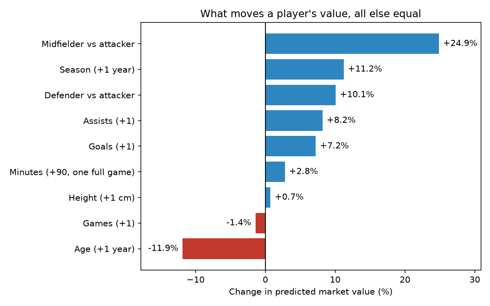

# ⚽ EPL Transfer Value Predictor

Can a Premier League player's season stats predict what he's worth?

This project trains a linear regression on **4,232 Premier League player-seasons (2012/13 to 2025/26)** of Transfermarkt data, then lets you search any player and compare the model's valuation with Transfermarkt's.

**Try it live:** _link coming soon_

## Headline result

The model explains about half of what drives market value, and the half it misses is the interesting part.

- **Typical error of €5.4m** (median) on 847 player-seasons the model never saw during training.
- **Age is the biggest single driver.** Each extra year costs about **12%** of a player's value, more than an extra goal adds (**+7%**).
- **It badly under-values stars.** Players worth €100m+ come out at around €40–55m. Their price depends on things season stats can't see: club, contract length, potential and reputation.

